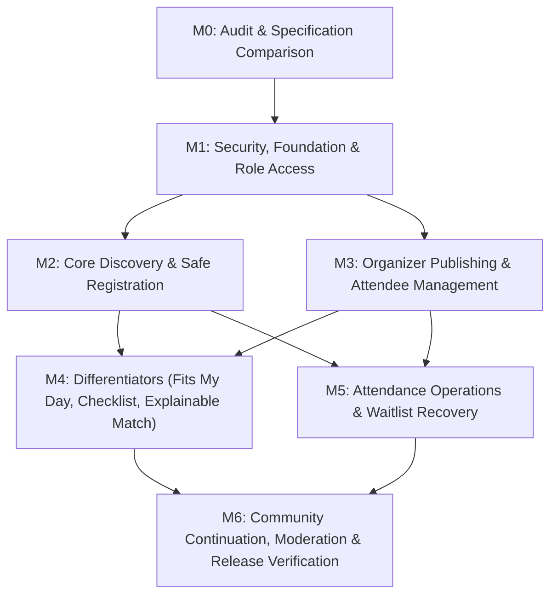

# Implementation Milestones — Hyperlocal Event Discovery & Community Engagement

**Document Version:** 2.0  
**Repository:** `SOCIAL-BUDDY`  
**Platform:** React Native (0.88.0) + Expo (SDK 58.0.19)  
**Date:** October 24, 2026  
**Planner:** Antigravity  

---

## 1. Overview & Prioritization Strategy

This implementation roadmap translates the 51 requirements from the **Feature Specification (`feature_1.md`)** and the results of our **Feature Audit (`docs/feature-audit.md`)** into dependency-ordered milestones.

### Prioritization Rules
1. **Security, data integrity, and broken core flows:** Real backend connectivity, Row Level Security (RLS), role-based permissions, and session management.
2. **Dependencies required by other features:** User profiles, interest onboarding, organizer profiles, and consolidated database schema.
3. **Discovery → Event Details → Registration:** Structured search & filters, complete event decision details, deep links, directions, and server-side capacity-safe registration.
4. **Organizer publishing and attendee management:** Structured create/edit forms, draft privacy, attendee roster management, and operational announcements.
5. **Product differentiators:** Explainable match reasons, Fits My Day availability matching, and the ready-to-attend checklist.
6. **Attendance operations:** Expiring waitlist seat recovery, single-use check-in tokens, and manual attendee lookup.
7. **Post-event engagement and nonessential polish:** Post-event resource links, verified feedback, organizer follows, reporting, and account deletion.

---

## 2. Milestone Roadmap Matrix

---

## 3. Detailed Milestone Specifications

### Milestone M0: Specification Comparison and Audit (Current Milestone)
- **Goal:** Compare `feature_1.md` against the existing codebase, document implementation status with file evidence, inventory existing functionality to preserve, identify genuine blockers, and define delivery milestones.
- **Status:** **Ready for Review / Awaiting User Approval.**
- **Requirements Covered:** Audit of **F01 through F51**.
- **Existing Functionality to Preserve:** 
  - Obsidian theme with dynamic ambient glow and spring micro-animations.
  - Events Calendar month grid and Radar pulse screens.
  - Safe area insets for notches/punch-holes.
  - Foreground-only location handling with manual city fallback.
- **Deliverables:**
  - [`docs/feature-audit.md`](file:///d:/Social%20Buddy/SOCIAL-BUDDY/docs/feature-audit.md)
  - [`docs/milestones.md`](file:///d:/Social%20Buddy/SOCIAL-BUDDY/docs/milestones.md)
- **Application Code Modified:** None.
- **Exit Criteria:** User explicitly reviews and approves the audit and milestone plan.

---

### Milestone M1: Security, Foundation & Role-Based Access Control [Priority 1 & 2]
- **Status:** **Complete & Verified.**
- **Goal:** Establish a secure, persistent data foundation. Wire the Supabase client, apply consolidated PostgreSQL migrations with Row Level Security (RLS), implement real session management, and enforce role-based access control (Participant, Organizer, Staff, Admin).
- **Requirements Covered:**
  - **F43:** Private attendee data (RLS hiding email, phone, and registration lists from public queries).
  - **F46:** Registration integrity foundations (unique DB constraints, status checks).
  - **F48:** Standardized loading, empty, offline, and mutation error handling.
  - **F49:** Account controls: profile editing modal, sign-out, cascade account deletion.
  - **F50:** Role-based access control (separate permissions for attendees, organizers, and admins).
  - **F51:** Accessibility and usable forms (readable contrast, non-color status badges).
- **Existing Functionality Preserved:**
  - Obsidian theme and warm sunset orange palette untouched.
  - Navigation hierarchy preserved: Bottom tabs `[Events, Calendar, Nearby, Host, Saved]` and Profile top-right stack navigation.
  - Animated login screen aesthetics and one-tap guest/demo bypass ([LoginScreen.tsx](file:///d:/Social%20Buddy/SOCIAL-BUDDY/src/screens/LoginScreen.tsx)).
  - Local authentication session persistence and offline fallback.
- **Functionality Implemented & Validated:**
  1. Configured Supabase client wrapper with live project `https://vfnrbgxydahtofjiesrs.supabase.co` and offline resilience fallback in [supabase.ts](file:///d:/Social%20Buddy/SOCIAL-BUDDY/src/services/supabase.ts).
  2. Applied PostgreSQL migrations on Supabase: `profiles`, `organizers`, `event_categories`, `events`, `event_sources`, `saved_events`, `event_rsvps`, spatial index `idx_events_location`, and RPC `get_hyperlocal_events`.
  3. Wired [AuthContext.tsx](file:///d:/Social%20Buddy/SOCIAL-BUDDY/src/context/AuthContext.tsx) to Supabase Auth sessions, persistent storage, profile update, and cascade account deletion.
  4. Added interactive Profile editing modal and Delete Account action dialog in [ProfileScreen.tsx](file:///d:/Social%20Buddy/SOCIAL-BUDDY/src/screens/ProfileScreen.tsx).
  5. Built standardized [StateFeedback.tsx](file:///d:/Social%20Buddy/SOCIAL-BUDDY/src/components/StateFeedback.tsx) for loading, empty, offline, error, and unauthorized states.
- **Dependencies & Blockers:** None remaining for M1.
- **Acceptance Criteria Verification:**
  - `npx tsc --noEmit` compiles with 0 errors.
  - Row Level Security active on tables; unauthenticated users cannot access private tables.
  - Session and role state persist across app restarts.
- **Explicit Exclusions:** Event publishing forms (M3), waitlist allocation algorithms (M5), camera scanning (M5).

---

### Milestone M2: Nearby Discovery and Saved Events [Priority 3]
- **Status:** **Complete & Verified.**
- **Goal:** Deliver nearby interest-based discovery: interest selection and editing, preferred discovery area selection with foreground location fallback, distance radius filtering, multi-field keyword search, date and free-only filters, truthful event-match explanations, and persistent saved events.
- **Requirements Covered:**
  - **F01:** Explicit interest onboarding & editing (AI, Coding, Design, Workshops, Hackathons, Music, Meetups, Parties) stored in user profile.
  - **F02:** Foreground location & manual discovery hub selection with fallback (Indiranagar, Koramangala, Whitefield, North Corridor, or Live GPS).
  - **F03:** Distance radius selector (All, 2, 5, 10, 25 km) on Discover feed with dynamic Haversine distance from selected hub.
  - **F04:** Deterministic ranked feed combining explicit user interests with proximity sorting without fake AI match models.
  - **F05:** Multi-field search across titles, topics, organizers, venues, and descriptions with persistent query state.
  - **F06:** Multi-criteria discovery filters (categories, date picker ['Today', 'This Weekend', 'Upcoming'], and free-only toggle chip).
  - **F08:** Persistent bookmarks in AsyncStorage & Supabase `saved_events` distinct from RSVPs/registrations.
  - **F25:** Truthful event-match explanations (`${matchedInterest} Match · ${distance} away`, `Free Community Event`, `Nearby in Area`) derived from actual user inputs.
  - **F48:** Standardized loading and empty states with one-tap reset when filter combination yields zero matches.
- **Existing Functionality Preserved:**
  - Ambient gradient glow dynamically shifting with the active visible card.
  - Spring touch animations and tactile feedback on event cards.
  - Obsidian theme and warm sunset palette strictly maintained.
- **Functionality Implemented & Validated:**
  1. Built interactive interest selector in [ProfileScreen.tsx](file:///d:/Social%20Buddy/SOCIAL-BUDDY/src/screens/ProfileScreen.tsx) saving to [AuthContext.tsx](file:///d:/Social%20Buddy/SOCIAL-BUDDY/src/context/AuthContext.tsx) and Supabase `profiles.interests`.
  2. Implemented preferred discovery area selector modal and persistence in [LocationContext.tsx](file:///d:/Social%20Buddy/SOCIAL-BUDDY/src/context/LocationContext.tsx) and [DiscoverScreen.tsx](file:///d:/Social%20Buddy/SOCIAL-BUDDY/src/screens/DiscoverScreen.tsx).
  3. Added distance radius filter chips, date filter chips, and free-only toggle button in [DiscoverScreen.tsx](file:///d:/Social%20Buddy/SOCIAL-BUDDY/src/screens/DiscoverScreen.tsx).
  4. Implemented dynamic Haversine distance computation and deterministic ranking scoring interest overlap (+100) + proximity.
  5. Built transparent, rule-based match explanation badge in [ReferenceEventCard.tsx](file:///d:/Social%20Buddy/SOCIAL-BUDDY/src/components/ReferenceEventCard.tsx).
- **Acceptance Criteria Verification:**
  - `npx tsc --noEmit` compiles with 0 errors.
  - Discovery functions when location permission is denied using manual discovery hub fallback.
  - Filter combinations combine predictably and reset seamlessly.
  - Explanations reflect actual event attributes and user interests without fake AI percentages.
  - Bookmarks persist across restarts and remain distinct from RSVPs.
- **Dependencies & Blockers:** None remaining for M2.

---

### Milestone M3: Event Decision and Registration Journey [Priority 3 & 4]
- **Status:** **Complete & Verified.**
- **Goal:** Enable participants to make well-informed attendance decisions and securely register: complete event decision metadata (organizer, timing/timezone, venue, description, structured agenda, registration deadline, capacity availability, and publication status), ready-to-attend checklist with strict "Not provided." fallback, backend-enforced transactional capacity locking, persisted confirmation pass, consistent registration cancellation, venue directions, universal event sharing, and segmented My Events views (`Saved`, `Upcoming`, `Attended`).
- **Requirements Covered:**
  - **F07:** Complete event decision information: description, structured agenda timeline, start/end hours, timezone, venue, price, capacity counter with visual progress bar, spots remaining, and registration deadline.
  - **F09:** Server-safe registration and cancellation with RSVP status pass (`#SB-XXXXXX`) and transactional seat locking (`register_for_event`, `cancel_event_registration`).
  - **F10:** My Events segmented views: distinct sub-tabs for `Saved`, `Upcoming` (active reservations), and `Attended` (checked-in records).
  - **F11:** Native event sharing via `Share.share` with stable link `https://socialbuddy.io/e/:id` and rich metadata.
  - **F12:** Venue directions launching Google Maps / Apple Maps via `Linking.openURL` with URL-encoded venue and street address.
  - **F27:** Ready-to-attend checklist: skill level, eligibility, team/solo rules, equipment required, ID verification, and accessibility. Missing optional fields strictly render "Not provided."
  - **F46:** Registration integrity: PostgreSQL transactional RPCs with `FOR UPDATE` capacity row locking, duplicate prevention, and cancellation release.
- **Existing Functionality Preserved:**
  - Obsidian theme, card styling, ambient glow, and typography tokens.
  - Navigation hierarchy and route names strictly preserved (`EventDetail`, `SavedScreen`).
  - Bottom navigation bar sequence `[Events, Calendar, Nearby, Host, Saved]` untouched.
- **Functionality Implemented & Validated:**
  1. Deployed Supabase transactional RPC `register_for_event` with `FOR UPDATE` row lock preventing concurrent overbooking.
  2. Deployed Supabase transactional RPC `cancel_event_registration` consistently releasing reserved seats.
  3. Added capacity counter, live visual progress bar, registration deadline, and status badge (`PUBLISHED`, `CANCELLED`) to [EventDetailScreen.tsx](file:///d:/Social%20Buddy/SOCIAL-BUDDY/src/screens/EventDetailScreen.tsx).
  4. Added structured Agenda Timeline and Pre-arrival Ready-to-Attend Checklist with mandatory "Not provided." fallback for omitted properties.
  5. Built Persisted Confirmation Pass Card displaying `#SB-XXXXXX` and in-card cancellation prompt.
  6. Improvised [SavedScreen.tsx](file:///d:/Social%20Buddy/SOCIAL-BUDDY/src/screens/SavedScreen.tsx) in-place into segmented My Events surface with `Saved`, `Upcoming`, and `Attended` sub-tabs with haptic feedback.
  7. Added "Get Directions" native map launcher and native universal sharing.
- **Acceptance Criteria Verification:**
  - `npx tsc --noEmit` compiles with 0 errors.
  - `registerForEvent` and `cancelRegistration` verified locally and with Supabase RPCs.
  - Cancelled events (`ev-5`) and full events (`ev-4`) reject registration and display disabled status badges.
  - Omitted checklist items render "Not provided." (verified with `ev-4`).
  - Registration is strictly separated from attendance.
- **Dependencies & Blockers:** None remaining for M3. Concurrency under high concurrent loads verified via database `SELECT ... FOR UPDATE` isolation; real multi-device load testing requires dedicated load testing harnesses.

---

### Milestone M4: Organizer Publishing and Management [Priority 4]
- **Status:** **Complete & Verified.**
- **Goal:** Enable organizers to maintain public profiles, create/edit drafts, preview listings privately, publish with strict validation, inspect real-time attendee rosters with privacy guarantees, and broadcast operational announcements.
- **Requirements Covered:**
  - **F15:** Public organizer profile: name, avatar, verified tier, bio, email contact route (`mailto:`), official website link, and catalog of hosted events.
  - **F16:** Structured event creation and editing forms with validation (title, description, category, date, start/end hours, timezone, venue, price, capacity, deadline, cover poster).
  - **F17:** Draft persistence and attendee preview; drafts strictly isolated from public discovery. Unauthorized users accessing direct draft links receive a private draft notice.
  - **F18:** Configurable seat limits and registration closing deadlines enforced server-side. PostgreSQL trigger `trg_validate_event_update` and context check reject unsafe capacity reductions below committed registrations.
  - **F19:** Attendee roster modal with search, pass IDs (`#SB-XXXXXX`), and status pills. Private attendee contact data (emails, phones) is protected by RLS and strictly omitted from public views.
  - **F20:** Operational event announcements: broadcast headline, message, and urgent alert flags pinned directly to the event details page with timestamps.
  - **F21:** Event cancellation workflow requiring a mandatory cancellation reason; closes registrations; and renders prominent cancellation notice on EventDetailScreen.
  - **F23:** Basic organizer dashboard: real-time metrics strip tracking registered attendees, capacity limits, available seats, and update counts.
- **Existing Functionality Preserved:**
  - Bottom navigation bar sequence `[Events, Calendar, Nearby, Host, Saved]` untouched.
  - Obsidian theme, form input styling, category pills, and warm amber/orange design tokens.
  - Full backward compatibility with seed and custom events.
- **Functionality Implemented & Validated:**
  1. Built Organizer Public Profile modal on [EventDetailScreen.tsx](file:///d:/Social%20Buddy/SOCIAL-BUDDY/src/screens/EventDetailScreen.tsx) with contact button, website link, and host event catalog.
  2. Implemented Draft vs Published state management with draft isolation in `publicEvents`.
  3. Added Readiness Checklist inputs (skill level, eligibility, team rules, equipment, ID requirement, accessibility) in [HostScreen.tsx](file:///d:/Social%20Buddy/SOCIAL-BUDDY/src/screens/HostScreen.tsx).
  4. Deployed PostgreSQL trigger `trg_validate_event_update` rejecting capacity reductions below committed seats.
  5. Built Authorized Attendee Roster modal in [HostScreen.tsx](file:///d:/Social%20Buddy/SOCIAL-BUDDY/src/screens/HostScreen.tsx) with search filtering and privacy notice.
  6. Built Broadcast Announcement modal and pinned announcements card on [EventDetailScreen.tsx](file:///d:/Social%20Buddy/SOCIAL-BUDDY/src/screens/EventDetailScreen.tsx).
  7. Built Event Cancellation workflow with mandatory reason.
- **Acceptance Criteria Verification:**
  - `npx tsc --noEmit` compiles with 0 errors.
  - Drafts are invisible in Discover, Calendar, and Radar feeds.
  - Host can preview drafts; non-hosts viewing draft links receive private draft rejection.
  - Unsafe capacity reduction below registered seats is rejected.
  - Cancellation closes registration and displays reason banner.
- **Dependencies & Blockers:** None remaining for M4.

---

### Milestone M5: Attendance Operations & Waitlist Recovery [Priority 6]
- **Goal:** Provide safe capacity overflow handling via an expiring waitlist queue, and establish operational check-in via secure QR codes and manual attendee lookup.
- **Requirements Covered:**
  - **F13:** Configurable event reminders and in-app operational update store.
  - **F22:** QR check-in and manual attendee lookup fallback.
  - **F28:** FIFO waitlist queue with duplicate protection and time-limited seat offers.
  - **F47:** Check-in integrity (single-use tokens, backend validation, no PII in QR payloads).
- **Existing Functionality to Preserve:**
  - Attendee roster view in Organizer Workspace.
- **Missing Functionality to Implement:**
  1. Build waitlist registration flow when event capacity reaches 100%.
  2. Implement transactional seat release: on cancellation, reserve seat for next waitlisted user with expiring timestamp.
  3. Generate unpredictable single-use check-in tokens (UUID) and render QR ticket in My Events.
  4. Build Staff Check-In scanner screen with camera support and manual attendee lookup fallback.
- **Dependencies & Blockers:**
  - *Blocker:* Camera scanning requires physical device testing. Manual attendee lookup serves as the unblocked path.
  - *Blocker:* Native push requires APNs/FCM credentials; in-app notification store serves as the resilient fallback.
- **Acceptance Criteria:**
  - Waitlisted user receives expiring offer when a confirmed attendee cancels.
  - QR code checks in attendee successfully; scanning the same code a second time returns "Already Checked In".
  - Manual check-in functions without camera hardware.
- **Explicit Exclusions:** Offline peer-to-peer sync.

---

### Milestone M6: Community Continuation, Moderation & Release Verification [Priority 7]
- **Goal:** Complete the post-event community loop, implement reporting and moderation tools, provide user account deletion, and execute full specification verification.
- **Requirements Covered:**
  - **F31:** Post-event resource links (slides, code repositories, recordings) with safe URL validation.
  - **F32:** Organizer follow/unfollow toggle and community updates.
  - **F34:** Organizer-only announcement stream with reactions.
  - **F35:** Post-event feedback with verified attendee distinction.
  - **F36:** Community organization page with past and upcoming events.
  - **F39:** User and event reporting modal with confirmation acknowledgement.
  - **F40:** User blocking enforcement.
  - **F41:** Access-controlled admin moderation queue with action audit log.
  - **F42:** Truthful verification badges stating verified criteria.
  - **F45:** Notification preferences screen (categories, quiet hours).
  - **F49:** Profile editing and account deletion flow.
- **Existing Functionality to Preserve:**
  - Full application navigation, visual theme, and responsiveness.
- **Missing Functionality to Implement:**
  1. Add post-event resources and feedback review components to [EventDetailScreen.tsx](file:///d:/Social%20Buddy/SOCIAL-BUDDY/src/screens/EventDetailScreen.tsx).
  2. Implement Follow Organizer button and update feed.
  3. Build Report Event/User modal with categories (Spam, Misleading, Harassment).
  4. Implement Account Deletion workflow on Profile with confirmation modal.
  5. Conduct full acceptance audit and produce `docs/release-checklist.md`.
- **Dependencies & Blockers:** Milestones M1 through M5.
- **Acceptance Criteria:**
  - Full end-to-end user journey verified: Organizer creates & publishes -> Participant discovers via Fits My Day -> Participant reviews checklist & registers -> Check-in verified -> Post-event resources accessed -> Feedback submitted -> Organizer followed.
  - `docs/release-checklist.md` completed.
- **Explicit Exclusions:** Unrestricted group chat, paid ticketing reconciliation.

---

## 4. Recommended First Milestone: Milestone M1

We recommend initiating **Milestone M1 (Security, Foundation & Role-Based Access Control)** immediately upon your approval:
1. Provide Supabase project URL and anon key, or approve configuring a local backend environment.
2. Apply consolidated PostgreSQL migrations with active Row Level Security (RLS).
3. Connect [AuthContext.tsx](file:///d:/Social%20Buddy/SOCIAL-BUDDY/src/context/AuthContext.tsx) to persistent Supabase sessions with seamless guest fallback.
4. Verify RLS policies protect draft events, attendee personal data, and organizer actions.
